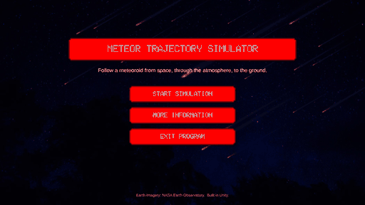
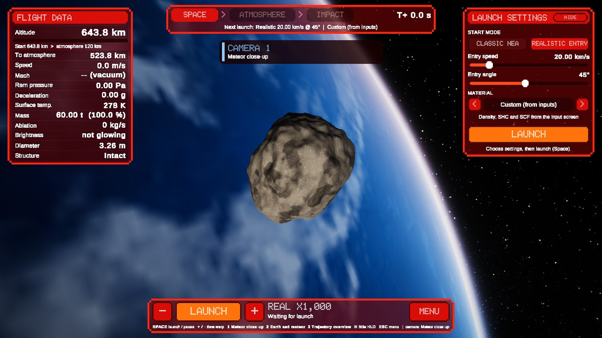
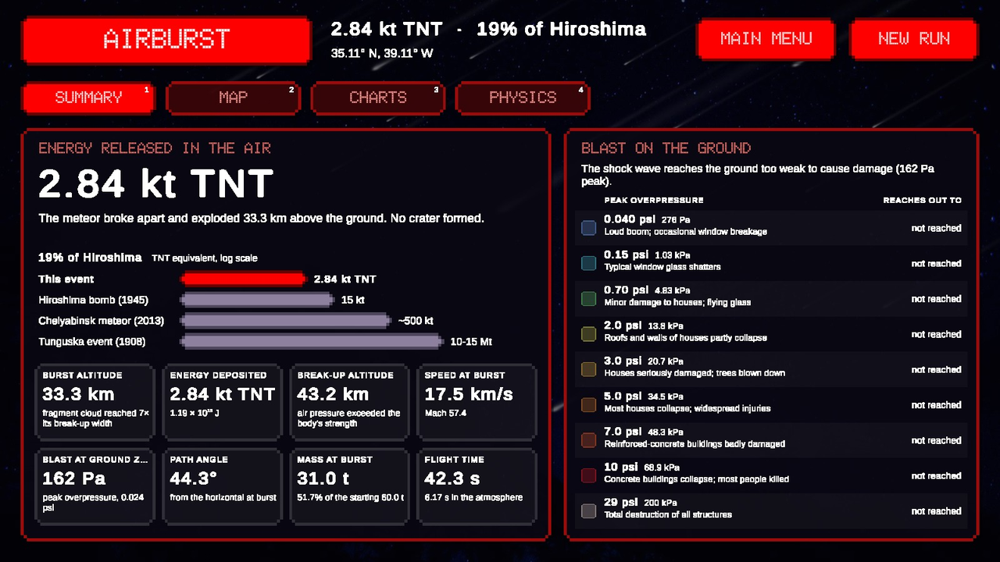

# Meteor Trajectory Simulator



A Unity simulation of a meteor falling towards Earth. You set the meteor's properties and starting position, then watch it fall through space, enter the atmosphere, and either burn up, explode in the air or hit the ground. The simulator then estimates the energy, crater and blast radii and shows where on Earth it happened.

**Quick start (Windows):** install Unity 2022.3.7f1, then double-click **`run.bat`**. See [Open & run](#open--run).

> My A-Level Computer Science NEA (AQA), built in Unity with C#.

## What it simulates

The physics is in a separate, unit-tested C# library (`Assets/Scripts/Core`); [docs/PHYSICS.md](docs/PHYSICS.md) gives the equations, units, assumptions and references.

- **Space stage:** 3-D motion under Earth's central gravity, integrated with **4th-order Runge-Kutta (RK4)** at a fixed step size. Two start modes:
  - **Classic NEA** (default): released from rest at the chosen coordinates.
  - **Realistic entry:** an inbound path that reaches the atmosphere at 17 km/s and 45° by default.
- **Atmosphere stage** (from 120 km altitude):
  - Air temperature, pressure and density from the **U.S. Standard Atmosphere 1976**
  - Drag from the velocity relative to the (wind-blown) air, with a drag coefficient that depends on Mach and Knudsen number
  - Heating and **ablation** from single-body meteor theory, with a stable (implicit) temperature update and a radiative-equilibrium starting temperature of about 278 K
  - **Fragmentation and airburst** using the "pancake" model from the Earth Impact Effects Program (EIEP): break-up when ram pressure exceeds the material strength
  - Wind speed and direction set with a drag-to-aim wind compass
  - The run ends in a ground impact, an airburst, or the meteor ablating away; every outcome goes to the results screen
- **Results screen** (tabs: Summary, Map, Charts, Physics):
  - Energy in kt/Mt TNT compared with Hiroshima, Chelyabinsk and Tunguska; crater size (transient and final, simple or complex) and blast radii for nine overpressure levels from Collins, Melosh & Marcus (2005), plus a point-source model so high airbursts such as Chelyabinsk still reach the ground
  - Dedicated airburst and burned-up outcomes (burst altitude, energy deposited, ground overpressure)
  - Geodesic damage rings on a pannable, zoomable world map with legend and scale bar; the end position is converted to latitude/longitude (allowing for Earth's rotation) and reverse-geocoded to a place name or ocean
  - Charts with axes and units: altitude-time, speed-altitude, mass-altitude, temperature-time

## Inputs and controls

- **Variable input screen:**
  - mass: 5,000 to 60,000 kg
  - density: 1,000 to 8,000 kg/m³
  - specific heat capacity: 400 to 1,500 J/(kg·K)
  - surface condition factor: 0 to 1
  - X/Y/Z starting coordinates: -50 to -1 or 1 to 50 (one unit is 4,050 km)

  Values outside a range are clamped. Blank fields use mid-range defaults. Either `.` or `,` works as the decimal mark.
- **Launch panel** (Space stage, before launch): Classic NEA or Realistic entry (entry speed 11-72 km/s, angle 5-90°), and the material: custom (from the inputs), one of four presets (stony, carbonaceous, stony-iron, iron) or a two-material mix. The command-line arguments `-mtsMode realistic`, `-mtsEntrySpeed 17000` and `-mtsEntryAngle 45` still work.
- **HUD:** altitude, speed, Mach, ram pressure, g-load, surface temperature, mass, ablation rate, brightness (absolute magnitude), stage indicator and event pop-ups (entry, break-up, airburst, impact). Hover any readout for a tooltip.
- **Keys:** Space = launch / pause / play, `+` / `-` = time warp (shown as real ×N; the step size stays fixed, a faster warp takes more steps per frame), `1`-`3` = cameras, `H` = hide HUD, `Esc` = menu.
- **Results:** `1`-`4` switch tabs; on the map drag to pan and scroll to zoom.
- The main menu has Start, Continue, Restart, Exit, and a More Information screen that links to background reading (RK4, drag coefficients, overpressure levels).

## Screenshots

| Launch settings and HUD | Atmospheric entry |
| --- | --- |
|  |  |
| **Results summary** | **Damage-ring map** |
|  |  |

The original NEA input screen is kept as it was: 

## Open & run

You need **Unity 2022.3.7f1** (the version in `ProjectSettings/ProjectVersion.txt`). Install **Unity Hub** from https://unity.com/download, then **Installs → Install Editor → 2022.3.7f1** (or get it from the [download archive](https://unity.com/releases/editor/archive)). Other 2022.3 LTS versions should work, but Unity will ask to upgrade the project.

### Easiest: `run.bat` (Windows)

Double-click **`run.bat`** in the repository folder, or run it from a terminal:

```powershell
.\run.bat              # builds the game the first time (a few minutes), then starts it
.\run.bat -Windowed    # play in a 1600x900 window instead of full screen
.\run.bat -Rebuild     # force a fresh build (it also rebuilds automatically when files change)
.\run.bat -Editor      # open the project in the Unity Editor on the main menu scene
```

The build goes to `Builds/Windows/MeteorTrajectorySimulator.exe` (gitignored); after the first build you can also start that `.exe` directly. The script finds Unity in the usual Unity Hub or standalone install folders; if yours is elsewhere, set `UNITY_EDITOR` to the full path of `Unity.exe`. Close the Unity Editor before building from the script (Unity can't open the same project twice).

### In the Unity Editor

1. In Unity Hub, **Projects → Add → Add project from disk** and select this folder (or run `.\run.bat -Editor`). The first open rebuilds `Library/`, which takes a few minutes.
2. Use **Tools → Meteor Simulator → Play from main menu**, or open `Assets/Scenes/MainMenu.unity` and press **Play**.

Scene order: `MainMenu` → `VariableInput` → `SpaceSimulation` → `AtmosphereReached` → `EarthCollision`.

### How to play

1. **Main menu → Start**, then enter the meteor's mass, density, specific heat capacity, surface condition factor and X/Y/Z start position, and press **Commence Simulation**.
2. In space, pick the start mode (Classic NEA or Realistic entry with speed and angle) and a material in **Launch settings**, then press **Launch** (or Space).
3. Use `+` / `-` for time warp, `1`-`3` for cameras and the wind compass in the atmosphere. The run ends in an impact, an airburst or the meteor burning up, then the results screen opens (tabs `1`-`4`).

### Making a Windows build by hand

`run.bat` does this for you. From the editor: **Tools → Meteor Simulator → Build Windows player**, or from a terminal:

```powershell
& "C:\Program Files\Unity\Hub\Editor\2022.3.7f1\Editor\Unity.exe" -batchmode -quit -projectPath . -executeMethod MTS.Launcher.Launcher.BuildWindows -logFile build.log
```

## Getting an API key

The impact location lookup uses the [geocode.maps.co](https://geocode.maps.co/) reverse-geocoding API, which needs a free API key. No key is stored in this repo. Without one, the simulation still runs and the collision screen shows "Location lookup unavailable - add an API key" in place of the place name.

1. Go to https://geocode.maps.co/ and click **Get API Key**.
2. Sign up for a free account.
3. Verify your email address using the link they send you.
4. Log in. Your API key is shown on your account dashboard. Copy it.
5. Free accounts are rate limited (roughly 1 request per second). See the site for the current limits. The simulator only makes one request per impact.

### Adding the key

The key is read when the collision scene loads, checking these in order:

**Option A: environment variable `GEOCODE_MAPS_CO_API_KEY`**

```powershell
# Windows (PowerShell), saved for your user account
setx GEOCODE_MAPS_CO_API_KEY "your-key-here"
```

Then fully close and reopen Unity Hub and the Unity Editor, because programs only see environment variables that existed when they started.

**Option B: `Assets/StreamingAssets/secrets.json`**

Copy `Assets/StreamingAssets/secrets.example.json` to `Assets/StreamingAssets/secrets.json` and put your key in it:

```json
{
    "geocodeMapsCoApiKey": "your-key-here"
}
```

`secrets.json` is gitignored, so it won't be committed. Note that Unity copies everything in `StreamingAssets` into a build, so a build made with this file in place contains your key. Don't share that build, or use the environment variable instead.

The code that loads the key is `GeocodeApiKey` in `Assets/Scripts/Results/ResultsGeocoder.cs`.

## Project layout

```
Assets/Scripts/Core/         Physics library (MTS.Core): USSA76 atmosphere, gravity, drag, heating/ablation,
                             fragmentation, RK4, impact model, simulation runner and session
Assets/Scripts/Session/      Glue between the input screen and the simulation session
Assets/Scripts/Space/        Space-stage adapter (Meteor_Force.cs)
Assets/Scripts/Atmosphere/   Atmosphere-stage adapter (AtmosphereForce.cs)
Assets/Scripts/UI/           Runtime HUD: flight data, launch panel, time warp, wind compass, toasts
Assets/Scripts/Results/      Results screen: summary, geodesic map rings, charts, geocoding (MTS.Results)
Assets/Editor/               Launcher (build / play entry points), HUD and results builders, screenshot tools
Assets/Scripts/Inputs/       Range-checked user inputs
Assets/Scripts/Main menu/    Scene navigation and info links
Assets/Tests/EditMode/       Unit tests (physics, HUD formatting and controls, results maths)
Assets/Scenes/               The six scenes
docs/PHYSICS.md              The physics model, equations and references
run.bat, run.ps1              One-click build-and-play entry point (Windows)
```

## Running the tests

In the Unity Editor, open **Window → General → Test Runner** and run the **EditMode** tests. Or run them from the command line (without `-quit`):

```powershell
& "C:\Program Files\Unity 2022.3.7f1\Editor\Unity.exe" -batchmode -nographics -projectPath . -runTests -testPlatform EditMode -testResults results.xml -logFile test.log
```
