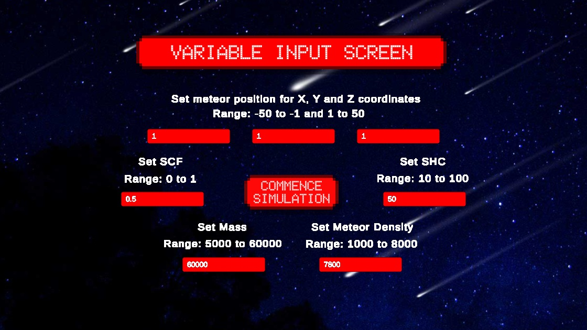
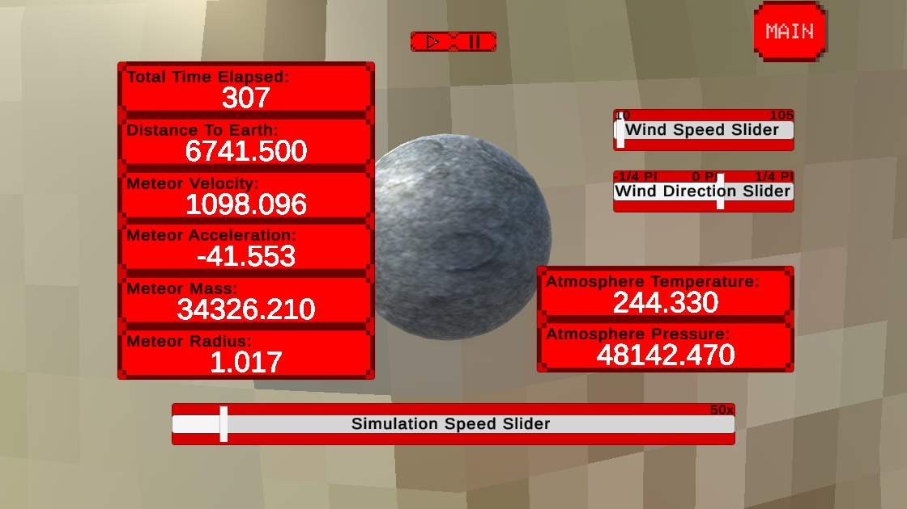
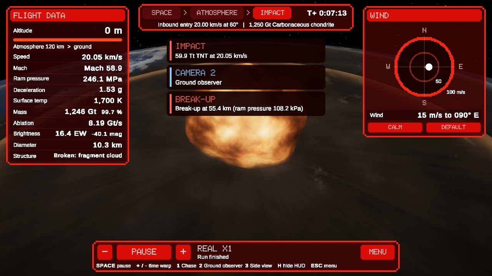

# Meteor Trajectory Simulator


*Visuals are an early version; a graphics overhaul is planned.*

A Unity simulation of a meteor falling towards Earth. You set the meteor's properties and starting position, then watch it fall through space, enter the atmosphere, and either burn up or hit the ground. If it hits, the simulator estimates the crater size and blast radii and shows where on Earth it landed.

> My A-Level Computer Science NEA (AQA), built in Unity with C#.

## What it simulates

The physics is in a separate, unit-tested C# library (`Assets/Scripts/Core`); [docs/PHYSICS.md](docs/PHYSICS.md) gives the equations, units, assumptions and references.

- **Space stage:** 3-D motion under Earth's central gravity, integrated with **4th-order Runge-Kutta (RK4)** at a fixed step size. Two start modes:
  - **Classic NEA** (default): released from rest at the chosen coordinates.
  - **Realistic entry:** an inbound path that reaches the atmosphere at 17 km/s and 45° by default.
- **Atmosphere stage** (from 120 km altitude):
  - Air temperature, pressure and density from the **U.S. Standard Atmosphere 1976**
  - Drag from the velocity relative to the (wind-blown) air, with a drag coefficient that depends on Mach and Knudsen number
  - Heating and **ablation** from single-body meteor theory, with a stable (implicit) temperature update and a radiative-equilibrium starting temperature of about 278 K
  - **Fragmentation and airburst** using the "pancake" model from the Earth Impact Effects Program (EIEP): break-up when ram pressure exceeds the material strength
  - Wind speed and direction set with sliders
  - The run ends in a ground impact, an airburst, or the meteor ablating away; every outcome goes to the results screen
- **Collision stage:**
  - Impact energy, crater size (transient and final, simple or complex) and blast radii for nine overpressure levels, from Collins, Melosh & Marcus (2005), drawn as rings on an Earth map
  - The end position is converted to latitude/longitude (allowing for Earth's rotation) and reverse-geocoded to a place name, or "Location is in the sea"
  - A graph of distance travelled over time

## Inputs and controls

- **Variable input screen:**
  - mass: 5,000 to 60,000 kg
  - density: 1,000 to 8,000 kg/m³
  - specific heat capacity: 400 to 1,500 J/(kg·K)
  - surface condition factor: 0 to 1
  - X/Y/Z starting coordinates: -50 to -1 or 1 to 50 (one unit is 4,050 km)

  Values outside a range are clamped. Blank fields use mid-range defaults. Either `.` or `,` works as the decimal mark.
- **Time-scale slider** speeds the simulation up or slows it down. The step size stays fixed; a faster time scale just takes more steps per frame.
- **Pause / play** pauses and resumes the simulation. Restart clears the run completely.
- **Start mode:** until there is a button for it, choose the mode with the `Realistic Entry Mode` option on the space scene's `Meteor_Force` component, or with the command-line arguments `-mtsMode realistic`, `-mtsEntrySpeed 17000` and `-mtsEntryAngle 45`.
- **Collision map:** mouse wheel to zoom, arrow keys / WASD to pan.
- The main menu has Start, Continue, Restart, Exit, and a More Information screen that links to background reading (RK4, drag coefficients, overpressure levels).

## Screenshots

| Variable input | Atmosphere stage | Impact map |
| --- | --- | --- |
|  |  |  |

## Open & run

1. Install **Unity Hub** from https://unity.com/download.
2. In Unity Hub, go to **Installs → Install Editor** and install **Unity 2022.3.7f1** (the version in `ProjectSettings/ProjectVersion.txt`). If it isn't listed, get it from the [Unity download archive](https://unity.com/releases/editor/archive). Other 2022.3 LTS versions should also work, but Unity will ask to upgrade the project.
3. In Unity Hub, go to **Projects → Add → Add project from disk** and select this folder. The first open rebuilds `Library/`, which takes a few minutes.
4. In the Project window, open **`Assets/Scenes/MainMenu.unity`** (the first scene in the build settings).
5. Press **Play**.

Scene order: `MainMenu` → `VariableInput` → `SpaceSimulation` → `AtmosphereReached` → `EarthCollision`.

### Making a Windows build

1. **File → Build Settings**. Check that all six scenes are ticked, with `MainMenu` at index 0.
2. Platform: **Windows, Mac, Linux**, Target Platform **Windows**, Architecture **x86_64**.
3. Click **Build**, choose an empty folder (e.g. `Builds/`, which is gitignored), and run the `.exe` it creates.

## Getting an API key

The impact location lookup uses the [geocode.maps.co](https://geocode.maps.co/) reverse-geocoding API, which needs a free API key. No key is stored in this repo. Without one, the simulation still runs and the collision screen shows "Location lookup unavailable - add an API key" in place of the place name.

1. Go to https://geocode.maps.co/ and click **Get API Key**.
2. Sign up for a free account.
3. Verify your email address using the link they send you.
4. Log in. Your API key is shown on your account dashboard. Copy it.
5. Free accounts are rate limited (roughly 1 request per second). See the site for the current limits. The simulator only makes one request per impact.

### Adding the key

The key is read when the collision scene loads, checking these in order:

**Option A: environment variable `GEOCODE_MAPS_CO_API_KEY`**

```powershell
# Windows (PowerShell), saved for your user account
setx GEOCODE_MAPS_CO_API_KEY "your-key-here"
```

Then fully close and reopen Unity Hub and the Unity Editor, because programs only see environment variables that existed when they started.

**Option B: `Assets/StreamingAssets/secrets.json`**

Copy `Assets/StreamingAssets/secrets.example.json` to `Assets/StreamingAssets/secrets.json` and put your key in it:

```json
{
    "geocodeMapsCoApiKey": "your-key-here"
}
```

`secrets.json` is gitignored, so it won't be committed. Note that Unity copies everything in `StreamingAssets` into a build, so a build made with this file in place contains your key. Don't share that build, or use the environment variable instead.

The code that loads the key is `ApiKeyLoader` in `Assets/Scripts/Collision/CoordinateCalculator.cs`.

## Project layout

```
Assets/Scripts/Core/         Physics library (MTS.Core): USSA76 atmosphere, gravity, drag, heating/ablation,
                             fragmentation, RK4, impact model, simulation runner and session
Assets/Scripts/Session/      Glue between the input screen and the simulation session
Assets/Scripts/Space/        Space-stage screen (Meteor_Force.cs)
Assets/Scripts/Atmosphere/   Atmosphere-stage screen, time and wind sliders (AtmosphereForce.cs)
Assets/Scripts/Collision/    Results screen: crater/blast radii, lat/long + geocoding, graph, map zoom
Assets/Scripts/Inputs/       Range-checked user inputs
Assets/Scripts/Main menu/    Scene navigation and info links
Assets/Tests/EditMode/       Unit tests for the physics library
Assets/Scenes/               The six scenes
docs/PHYSICS.md              The physics model, equations and references
```

## Running the tests

In the Unity Editor, open **Window → General → Test Runner** and run the **EditMode** tests. Or run them from the command line (without `-quit`):

```powershell
& "C:\Program Files\Unity 2022.3.7f1\Editor\Unity.exe" -batchmode -nographics -projectPath . -runTests -testPlatform EditMode -testResults results.xml -logFile test.log
```
