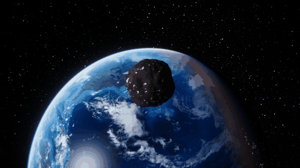
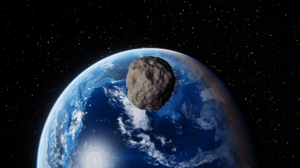
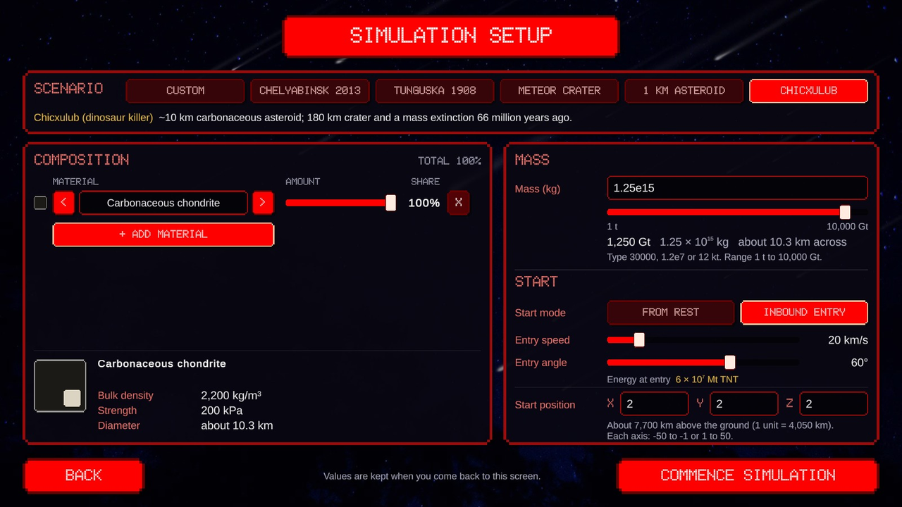
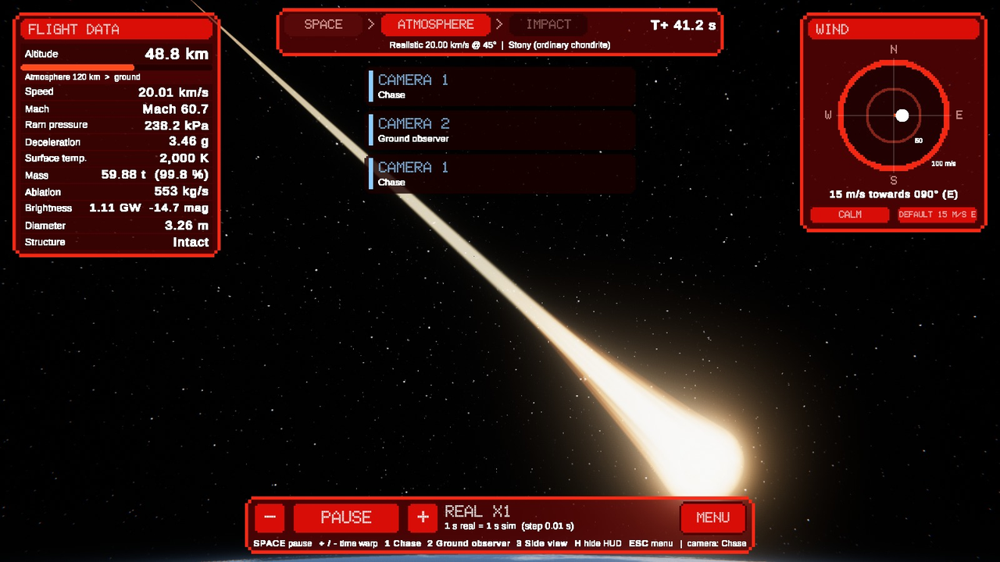
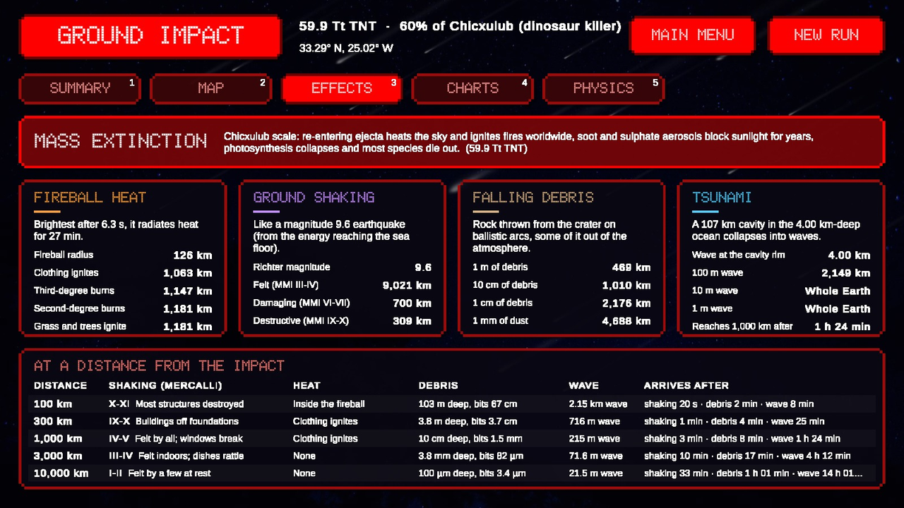
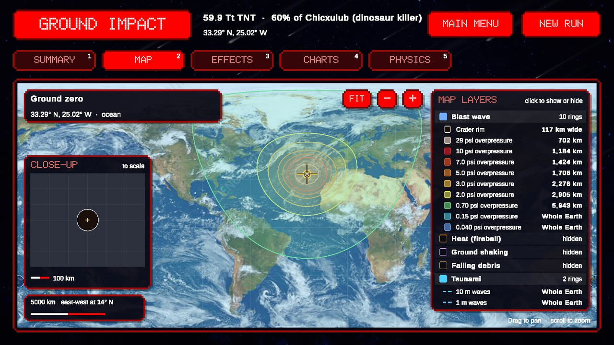

# Meteor Trajectory Simulator



A Unity simulation of a meteor falling towards Earth, from a house-sized fireball to the dinosaur killer. You pick a famous impact or design your own (mass and a mix of up to four materials), then watch it fall through space, enter the atmosphere, and either burn up, explode in the air or hit the ground. The simulator then estimates the energy, crater, blast, heat, earthquake, debris and tsunami effects and shows where on Earth it happened.

**Quick start (Windows):** install Unity 2022.3.7f1, then double-click **`run.bat`**. See [Open & run](#open--run).

> My A-Level Computer Science NEA (AQA), built in Unity with C#.

## What it simulates

The physics is in a separate, unit-tested C# library (`Assets/Scripts/Core`); [docs/PHYSICS.md](docs/PHYSICS.md) gives the equations, units, assumptions and references.

- **Setup:** famous scenarios (Chelyabinsk 2013, Tunguska 1908, Meteor Crater, a 1 km asteroid, Chicxulub) or a custom meteoroid: mass from 1 t to 10,000 Gt and a composition of up to four of eight materials (ordinary, carbonaceous and enstatite chondrites, basaltic achondrite, stony-iron, iron, cometary ice and dust, rubble pile) that sets its density, heat capacity, ablation, strength and look.
- **Space stage:** 3-D motion under Earth's central gravity, integrated with **4th-order Runge-Kutta (RK4)** at a fixed step size. Two start modes:
  - **From rest:** released at rest at the chosen coordinates and falls under gravity.
  - **Inbound entry:** an inbound path that reaches the atmosphere at a chosen speed (11-72 km/s) and angle.
- **Atmosphere stage** (from 120 km altitude):
  - Air temperature, pressure and density from the **U.S. Standard Atmosphere 1976**
  - Drag from the velocity relative to the (wind-blown) air, with a drag coefficient that depends on Mach and Knudsen number
  - Heating and **ablation** from single-body meteor theory, with a stable (implicit) temperature update and a radiative-equilibrium starting temperature of about 278 K
  - **Fragmentation and airburst** using the "pancake" model from the Earth Impact Effects Program (EIEP): break-up when ram pressure exceeds the material strength
  - Wind speed and direction set with a drag-to-aim wind compass
  - The run ends in a ground impact, an airburst, or the meteor ablating away; every outcome goes to the results screen
- **Results screen** (tabs: Summary, Map, Effects, Charts, Physics):
  - Energy in kt to Tt of TNT compared with Hiroshima, Chelyabinsk, Tunguska, Meteor Crater and Chicxulub, with a severity rating from local to mass extinction
  - Crater size and blast radii for nine overpressure levels from the Earth Impact Effects Program (Collins, Melosh & Marcus 2005), plus a point-source model so high airbursts such as Chelyabinsk still reach the ground
  - **Effects:** fireball heat and burn/ignition radii, earthquake magnitude and shaking by distance, ejecta thickness and arrival times, and for ocean impacts the water cavity and tsunami heights
  - Dedicated airburst and burned-up outcomes (burst altitude, energy deposited, ground overpressure)
  - Geodesic damage rings (blast, heat, shaking, debris, tsunami; toggleable) on a pannable, zoomable world map that handles planet-sized effects; the end point is converted to latitude/longitude (allowing for Earth's rotation) and reverse-geocoded to a place name or ocean
  - Charts with axes and units: altitude-time, speed-altitude, mass-altitude, temperature-time
- **Graphics:** a true-scale Earth (NASA Blue and Black Marble), a procedural rock textured by its composition, plasma, ablation sparks and ionisation trail, Cinemachine cameras, and an end sequence scaled to the event: from a small crater up to a global fireball, ejecta curtain, ash and shock rings seen from orbit

## Inputs and controls

- **Setup screen:** a scenario (or Custom), the composition mixer (up to four materials with amounts; the shares always total 100%), mass (type `60000`, `1.2e7` or `12 kt`, or use the log slider; 1 t to 10,000 Gt), the start mode with entry speed and angle, and the X/Y/Z start coordinates (-50 to -1 or 1 to 50 each; one unit is 4,050 km). Values are kept when you come back to the screen.
- **Launch panel** (Space stage, before launch): From rest or Inbound entry with speed and angle, and a read-only summary of the meteoroid. The command-line arguments `-mtsMode rest|inbound`, `-mtsEntrySpeed 17000`, `-mtsEntryAngle 45` and `-mtsScenario chelyabinsk|tunguska|barringer|one-km|chicxulub` also work.
- **HUD:** altitude, speed, Mach, ram pressure, g-load, surface temperature, mass, ablation rate, brightness (absolute magnitude), stage indicator and event pop-ups (entry, break-up, airburst, impact). Hover any readout for a tooltip.
- **Keys:** Space = launch / pause / play, `+` / `-` = time warp (shown as real ×N; the step size stays fixed, a faster warp takes more steps per frame), `1`-`3` = cameras, `H` = hide HUD, `Esc` = menu.
- **Results:** `1`-`5` switch tabs; on the map drag to pan, scroll to zoom and click the legend to show or hide layers.
- The main menu and the pause menu (Esc) have a More Information page: what it does, the stages, the physics in plain words with links to background reading, the controls and credits.

## Walkthrough


| Tunguska 1908: a stony airburst over the ocean |
| --- |
|  |

## Screenshots

| Setup | Launch settings and HUD |
| --- | --- |
|  |  |
| **Atmospheric entry** | **Impact** |
|  |  |
| **Results summary** | **Effects** |
|  |  |
| **Damage-ring map** | |
|  | |

## Open & run

You need **Unity 2022.3.7f1** (the version in `ProjectSettings/ProjectVersion.txt`). Install **Unity Hub** from https://unity.com/download, then **Installs → Install Editor → 2022.3.7f1** (or get it from the [download archive](https://unity.com/releases/editor/archive)). Other 2022.3 LTS versions should work, but Unity will ask to upgrade the project.

### Easiest: `run.bat` (Windows)

Double-click **`run.bat`** in the repository folder, or run it from a terminal:

```powershell
.\run.bat              # builds the game the first time (a few minutes), then starts it
.\run.bat -Windowed    # play in a 1600x900 window instead of full screen
.\run.bat -Rebuild     # force a fresh build (it also rebuilds automatically when files change)
.\run.bat -Editor      # open the project in the Unity Editor on the main menu scene
```

The build goes to `Builds/Windows/MeteorTrajectorySimulator.exe` (gitignored); after the first build you can also start that `.exe` directly. The script finds Unity in the usual Unity Hub or standalone install folders; if yours is elsewhere, set `UNITY_EDITOR` to the full path of `Unity.exe`. Close the Unity Editor before building from the script (Unity can't open the same project twice).

### In the Unity Editor

1. In Unity Hub, **Projects → Add → Add project from disk** and select this folder (or run `.\run.bat -Editor`). The first open rebuilds `Library/`, which takes a few minutes.
2. Use **Tools → Meteor Simulator → Play from main menu**, or open `Assets/Scenes/MainMenu.unity` and press **Play**.

Scene order: `MainMenu` → `VariableInput` → `SpaceSimulation` → `AtmosphereReached` → `EarthCollision`.

### How to play

1. **Main menu → Start**, then pick a scenario or set the mass, mix up to four materials, choose From rest or Inbound entry and the X/Y/Z start position, and press **Commence Simulation**.
2. In space, check the start mode in **Launch settings** (you can still switch From rest / Inbound entry and change speed and angle), then press **Launch** (or Space).
3. Use `+` / `-` for time warp, `1`-`3` for cameras and the wind compass in the atmosphere. The run ends in an impact, an airburst or the meteor burning up, then the results screen opens (tabs `1`-`5`).

### Making a Windows build by hand

`run.bat` does this for you. From the editor: **Tools → Meteor Simulator → Build Windows player**, or from a terminal:

```powershell
& "C:\Program Files\Unity\Hub\Editor\2022.3.7f1\Editor\Unity.exe" -batchmode -quit -projectPath . -executeMethod MTS.Launcher.Launcher.BuildWindows -logFile build.log
```

## Getting an API key

The impact location lookup uses the [geocode.maps.co](https://geocode.maps.co/) reverse-geocoding API, which needs a free API key. No key is stored in this repo. Without one, the simulation still runs and the collision screen shows "Location lookup unavailable - add an API key" in place of the place name.

1. Go to https://geocode.maps.co/ and click **Get API Key**.
2. Sign up for a free account.
3. Verify your email address using the link they send you.
4. Log in. Your API key is shown on your account dashboard. Copy it.
5. Free accounts are rate limited (roughly 1 request per second). See the site for the current limits. The simulator only makes one request per impact.

### Adding the key

The key is read when the collision scene loads, checking these in order:

**Option A: environment variable `GEOCODE_MAPS_CO_API_KEY`**

```powershell
# Windows (PowerShell), saved for your user account
setx GEOCODE_MAPS_CO_API_KEY "your-key-here"
```

Then fully close and reopen Unity Hub and the Unity Editor, because programs only see environment variables that existed when they started.

**Option B: `Assets/StreamingAssets/secrets.json`**

Copy `Assets/StreamingAssets/secrets.example.json` to `Assets/StreamingAssets/secrets.json` and put your key in it:

```json
{
    "geocodeMapsCoApiKey": "your-key-here"
}
```

`secrets.json` is gitignored, so it won't be committed. Note that Unity copies everything in `StreamingAssets` into a build, so a build made with this file in place contains your key. Don't share that build, or use the environment variable instead.

The code that loads the key is `GeocodeApiKey` in `Assets/Scripts/Results/ResultsGeocoder.cs`.

## Project layout

```
Assets/Scripts/Core/         Physics library (MTS.Core): USSA76 atmosphere, gravity, drag, heating/ablation,
                             fragmentation, RK4, impact model, simulation runner and session
Assets/Scripts/Session/      Glue between the input screen and the simulation session
Assets/Scripts/Space/        Space-stage adapter (Meteor_Force.cs)
Assets/Scripts/Atmosphere/   Atmosphere-stage adapter (AtmosphereForce.cs)
Assets/Scripts/UI/           Runtime HUD: flight data, launch panel, time warp, wind compass, toasts
Assets/Scripts/Results/      Results screen: summary, effects, geodesic map rings, charts, geocoding (MTS.Results)
Assets/Scripts/Menus/        Main menu, pause menu and setup screen (composition mixer, scenarios)
Assets/Scripts/Visuals/      Earth, meteor, cameras and end sequence
Assets/Editor/               Launcher (build / play entry points), HUD and results builders, screenshot tools
Assets/Scripts/Inputs/       Range-checked user inputs
Assets/Scripts/Main menu/    Scene navigation and info links
Assets/Tests/EditMode/       Unit tests (physics, HUD formatting and controls, results maths)
Assets/Scenes/               The six scenes
docs/PHYSICS.md              The physics model, equations and references
run.bat, run.ps1              One-click build-and-play entry point (Windows)
```

## Running the tests

In the Unity Editor, open **Window → General → Test Runner** and run the **EditMode** tests. Or run them from the command line (without `-quit`):

```powershell
& "C:\Program Files\Unity 2022.3.7f1\Editor\Unity.exe" -batchmode -nographics -projectPath . -runTests -testPlatform EditMode -testResults results.xml -logFile test.log
```
